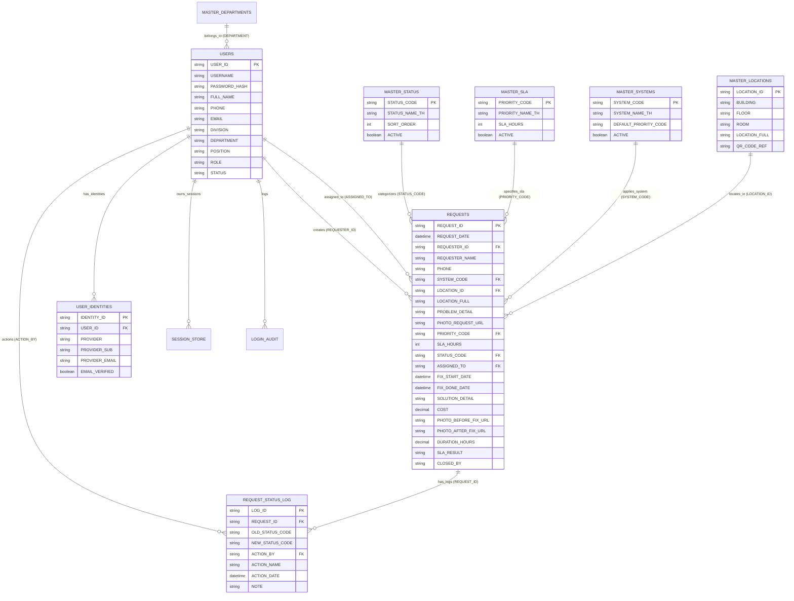
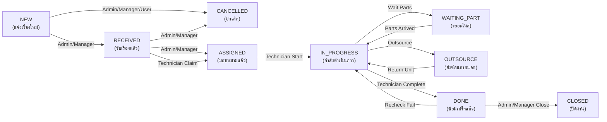

# 📊 ผังสถาปัตยกรรมข้อมูล และกระบวนการดำเนินงาน (Data Diagram & Workflow)
### FRS : Facility Repair System (ระบบแจ้งซ่อมบำรุงออนไลน์ — Mobile Full Option)
**Database: Google Sheets (`DBS_FRS`) — 13 ตาราง | Developer: LongZe Design**

เอกสารฉบับนี้อธิบายโครงสร้างสถาปัตยกรรมฐานข้อมูลเชิงสัมพันธ์ (Relational Data Model), พจนานุกรมข้อมูล (Data Dictionary) และผังกระบวนการทำงาน (Workflow Engine) ของระบบ FRS อย่างละเอียด

---

## 📋 สารบัญ
1. [ผังความสัมพันธ์เอนทิตี (Entity-Relationship Diagram: 13 Tables)](#1-ผังความสัมพันธ์เอนทิตี-entity-relationship-diagram)
2. [พจนานุกรมข้อมูล (Data Dictionary)](#2-พจนานุกรมข้อมูล-data-dictionary)
3. [วงจรสถานะงานซ่อม 9 ขั้นตอน (State Transition Engine)](#3-วงจรสถานะงานซ่อม-9-ขั้นตอน-state-transition-engine)
4. [ตรรกะการคำนวณ SLA และดัชนีประสิทธิภาพ (SLA Metrics Calculation)](#4-ตรรกะการคำนวณ-sla-และดัชนีประสิทธิภาพ)
5. [การจัดการความปลอดภัยและวงจรเซสชัน (Session Lifecycle)](#5-การจัดการความปลอดภัยและวงจรเซสชัน)

---

## 1. ผังความสัมพันธ์เอนทิตี (Entity-Relationship Diagram)

---

## 2. พจนานุกรมข้อมูล (Data Dictionary)

### 2.1 ตาราง `USERS` (บัญชีผู้ใช้งาน)
| ชื่อฟิลด์ | ประเภทข้อมูล | คีย์ | คำอธิบาย |
| :--- | :--- | :---: | :--- |
| `USER_ID` | String (20) | **PK** | รหัสผู้ใช้เฉพาะ เช่น `U-ADMIN-001`, `U-USER-001` |
| `USERNAME` | String (80) | **UK** | ชื่อเข้าสู่ระบบ (Case-insensitive) |
| `PASSWORD_HASH` | String (255) | - | รหัสผ่านแฮชแบบ PBKDF2 (`v2$5000$salt$hash`) |
| `FULL_NAME` | String (200) | - | ชื่อ-นามสกุลจริงของผู้ใช้งาน |
| `PHONE` | String (30) | - | หมายเลขโทรศัพท์ในรูปแบบสากล `+66xxxxxxxxx` |
| `EMAIL` | String (200) | - | อีเมลสำหรับติดต่อและยืนยันตัวตน |
| `DIVISION` | String (100) | - | ฝ่ายต้นสังกัด |
| `DEPARTMENT` | String (100) | - | แผนกหรือหน่วยงานย่อย |
| `POSITION` | String (100) | - | ตำแหน่งงาน |
| `ROLE` | String (20) | - | สิทธิ์การใช้งาน (`USER`, `TECHNICIAN`, `MANAGER`, `ADMIN`) |
| `STATUS` | String (20) | - | สถานะบัญชี (`ACTIVE`, `INACTIVE`, `SUSPENDED`) |
| `FAILED_LOGIN_COUNT`| Integer | - | จำนวนครั้งที่กรอกรหัสผิดสะสม |
| `LOCKED_UNTIL` | DateTime | - | เวลาที่ระงับการเข้าสู่ระบบชั่วคราว |
| `LAST_LOGIN` | DateTime | - | เวลาเข้าสู่ระบบล่าสุด |

---

### 2.2 ตาราง `REQUESTS` (ใบแจ้งซ่อมหลัก)
| ชื่อฟิลด์ | ประเภทข้อมูล | คีย์ | คำอธิบาย |
| :--- | :--- | :---: | :--- |
| `REQUEST_ID` | String (20) | **PK** | เลขที่ใบแจ้งซ่อม เช่น `REQ-202611-001` |
| `REQUEST_DATE` | DateTime | - | วันที่และเวลาที่ผู้ใช้ส่งแจ้งซ่อม |
| `REQUESTER_ID` | String (20) | **FK** | รหัสผู้ใช้งานที่แจ้งซ่อม |
| `REQUESTER_NAME`| String (200) | - | ชื่อผู้แจ้งซ่อม (Snapshot ณ เวลาแจ้ง) |
| `PHONE` | String (30) | - | เบอร์โทรติดต่อผู้แจ้ง (สำหรับ One-Touch Call) |
| `SYSTEM_CODE` | String (20) | **FK** | รหัสระบบงาน เช่น `EE` (ไฟฟ้า), `AC` (แอร์) |
| `SYSTEM_NAME_TH`| String (100) | - | ชื่อระบบงานภาษาไทย |
| `LOCATION_ID` | String (20) | **FK** | รหัสสถานที่ เช่น `LOC-001` |
| `LOCATION_FULL` | String (255) | - | ชื่อสถานที่เต็ม (อาคาร ชั้น ห้อง) |
| `PROBLEM_DETAIL`| Text | - | รายละเอียดอาการชำรุดเสียหาย |
| `PHOTO_REQUEST_URL`| String (500) | - | URL รูปภาพอาการเสียบน Google Drive |
| `PRIORITY_CODE` | String (20) | **FK** | ระดับความเร่งด่วน (`LOW`, `NORMAL`, `HIGH`, `CRITICAL`, `PM`) |
| `SLA_HOURS` | Integer | - | กรอบเวลา SLA ที่ต้องเสร็จสิ้น (ชั่วโมง) |
| `STATUS_CODE` | String (20) | **FK** | สถานะงานซ่อมปัจจุบัน |
| `STATUS_NAME_TH`| String (50) | - | ชื่อสถานะภาษาไทย |
| `ASSIGNED_TO` | String (20) | **FK** | รหัสช่างผู้รับผิดชอบงาน |
| `RECEIVED_DATE` | DateTime | - | วันที่รับเรื่อง |
| `FIX_START_DATE`| DateTime | - | วันที่ช่างเริ่มลงมือปฏิบัติงาน |
| `FIX_DONE_DATE` | DateTime | - | วันที่ช่างบันทึกดำเนินงานเสร็จสิ้น |
| `SOLUTION_DETAIL`| Text | - | บันทึกวิธีการแก้ไข ปัญหาที่พบ หรืออุปกรณ์ที่เปลี่ยน |
| `COST` | Decimal (12,2) | - | ค่าใช้จ่ายรวมในการซ่อมบำรุง (บาท) |
| `PHOTO_BEFORE_FIX_URL`| String (500)| - | รูปถ่ายหน้างานก่อนเริ่มลงมือซ่อม |
| `PHOTO_AFTER_FIX_URL` | String (500)| - | รูปถ่ายหน้างานหลังซ่อมเสร็จสิ้น |
| `DURATION_HOURS`| Decimal (8,2) | - | เวลาที่ใช้ตั้งแต่เริ่มจนจบงาน (ชั่วโมง) |
| `SLA_RESULT` | String (20) | - | ผลการประเมิน SLA (`PASSED`, `BREACHED`) |
| `CLOSED_BY` | String (200) | - | ชื่อแอดมินหรือหัวหน้างานผู้ตรวจสอบและปิดงาน |

---

### 2.3 ตาราง `REQUEST_STATUS_LOG` (ประวัติการเปลี่ยนสถานะ)
| ชื่อฟิลด์ | ประเภทข้อมูล | คีย์ | คำอธิบาย |
| :--- | :--- | :---: | :--- |
| `LOG_ID` | String (30) | **PK** | รหัสบันทึกไทม์ไลน์ เช่น `LOG-xxxxxxxx` |
| `REQUEST_ID` | String (20) | **FK** | อ้างอิงใบแจ้งซ่อมที่เกี่ยวข้อง |
| `OLD_STATUS_CODE`| String (20) | - | สถานะเดิมก่อนหน้า |
| `NEW_STATUS_CODE`| String (20) | - | สถานะใหม่ที่เปลี่ยนไป |
| `ACTION_BY` | String (20) | **FK** | รหัสผู้กระทำการเปลี่ยนสถานะ |
| `ACTION_NAME` | String (200) | - | ชื่อผู้กระทำการ |
| `ACTION_DATE` | DateTime | - | วันที่และเวลาที่มีการบันทึก |
| `NOTE` | Text | - | บันทึกช่วยจำเพิ่มเติม หรือเหตุผลการยกเลิก/ส่งซ่อม |

---

## 3. วงจรสถานะงานซ่อม 9 ขั้นตอน (State Transition Engine)

ระบบ FRS บังคับใช้กฎเกณฑ์ Workflow อย่างเข้มงวด โดยผู้ใช้งานแต่ละ Role จะมีสิทธิ์เปลี่ยนสถานะได้ตามที่กำหนดไว้ใน `WorkflowService.js`:

| รหัสสถานะ | ชื่อภาษาไทย | คำอธิบาย | Role ที่มีสิทธิ์เปลี่ยนเข้าสู่สถานะ |
| :--- | :--- | :--- | :--- |
| **`NEW`** | แจ้งเรื่องใหม่ | ผู้ใช้ส่งคำขอแจ้งซ่อมเข้ามาใหม่ | `USER`, `ADMIN`, `MANAGER` |
| **`RECEIVED`** | รับเรื่องแล้ว | แอดมินหรือหัวหน้างานตรวจสอบความถูกต้องของข้อมูล | `ADMIN`, `MANAGER` |
| **`ASSIGNED`** | มอบหมายแล้ว | กำหนดช่างผู้รับผิดชอบงาน หรือช่างกดรับงานเอง (Claim) | `ADMIN`, `MANAGER`, `TECHNICIAN` |
| **`IN_PROGRESS`** | กำลังดำเนินการ | ช่างเริ่มลงมือปฏิบัติงานหน้างาน | `TECHNICIAN`, `ADMIN` |
| **`WAITING_PART`** | รออะไหล่ | งานติดปัญหาต้องรอเบิกหรือสั่งซื้ออุปกรณ์ | `TECHNICIAN`, `ADMIN` |
| **`OUTSOURCE`** | ส่งซ่อมภายนอก | ส่งผู้รับเหมาหรือศูนย์บริการภายนอก | `TECHNICIAN`, `ADMIN` |
| **`DONE`** | ซ่อมเสร็จแล้ว | ช่างแก้ไขเสร็จสิ้น บันทึกผล แนบรูป และค่าใช้จ่าย | `TECHNICIAN`, `ADMIN` |
| **`CLOSED`** | ปิดงาน | แอดมินหรือหัวหน้างานตรวจสอบผลงานและปิดงาน | `ADMIN`, `MANAGER` |
| **`CANCELLED`** | ยกเลิก | ยกเลิกคำขอพร้อมระบุเหตุผลประกอบ | `ADMIN`, `MANAGER`, `USER` (ก่อนรับเรื่อง) |

---

## 4. ตรรกะการคำนวณ SLA และดัชนีประสิทธิภาพ

ระบบคำนวณระยะเวลา SLA ตามค่าในชีต `MASTER_SLA`:

| ระดับความเร่งด่วน (`PRIORITY_CODE`) | กรอบเวลา SLA | ข้อความ SLA | วัตถุประสงค์การใช้งาน |
| :--- | :---: | :--- | :--- |
| **`CRITICAL`** | **4 ชม.** | ภายใน 2-4 ชม. (24 ชม./ทุกวัน) | กระทบความปลอดภัย ชีวิต ทรัพย์สิน หรือระบบหลักหยุดทำงาน |
| **`HIGH`** | **8 ชม.** (1 วันทำการ) | ภายใน 4-8 ชม. (1 วันทำการ) | กระทบผู้ใช้กลุ่มใหญ่ ห้องประชุมสำคัญ หรือบริการลูกค้า |
| **`NORMAL`** | **24 ชม.** (1-2 วันทำการ) | ภายใน 24-48 ชม. (1-2 วันทำการ) | งานทั่วไป ไม่ส่งผลกระทบต่อการทำงานหลัก |
| **`LOW`** | **72 ชม.** (3-5 วันทำการ) | ภายใน 3-5 วันทำการ | งานปรับปรุง งานตกแต่ง หรืองานย่อยที่มีอุปกรณ์ทดแทน |
| **`PM`** | **168 ชม.** (7 วันทำการ) | ภายใน 7 วันทำการ | งานตรวจเช็กบำรุงรักษาเชิงป้องกันตามรอบ |

### สูตรคำนวณใน `WorkflowService.js`:
$$\text{Duration (Hours)} = \frac{\text{FIX\_DONE\_DATE} - \text{REQUEST\_DATE}}{1000 \times 60 \times 60}$$

$$\text{SLA\_RESULT} = \begin{cases} \text{PASSED} & \text{ถ้า } \text{Duration} \le \text{SLA\_HOURS} \\ \text{BREACHED} & \text{ถ้า } \text{Duration} > \text{SLA\_HOURS} \end{cases}$$

---

## 5. การจัดการความปลอดภัยและวงจรเซสชัน

1. **การเข้ารหัสผ่าน (Password Security):**
   - ใช้อัลกอริทึม **PBKDF2 Salted SHA-256** (5,000 Iterations)
   - ป้องกัน Brute-force ด้วยระบบล็อกบัญชีอัตโนมัติ 15 นาที เมื่อกรอกผิดติดต่อกัน 5 ครั้ง
2. **Session Storage:**
   - เซสชันถูกจัดเก็บในตาราง `SESSION_STORE` และแคชผ่าน Google CacheService
   - หมดอายุอัตโนมัติภายใน 6 ชั่วโมง (`SESSION_EXPIRE_SECONDS = 21600`)
3. **Data Protection & Sanitization:**
   - ป้องกัน XSS Injection ด้วยฟังก์ชัน `Utils.sanitize()` และ `escapeHtml()` ก่อนเรนเดอร์ทุกจุด
   - ค้นหาข้อมูลแบบ Case-insensitive และป้องกันช่องโหว่การเขียนทับข้ามบทบาท (Role Boundary Verification)
