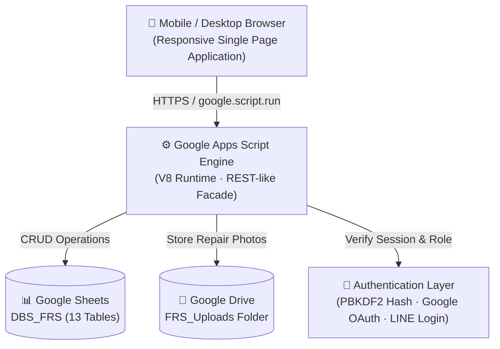
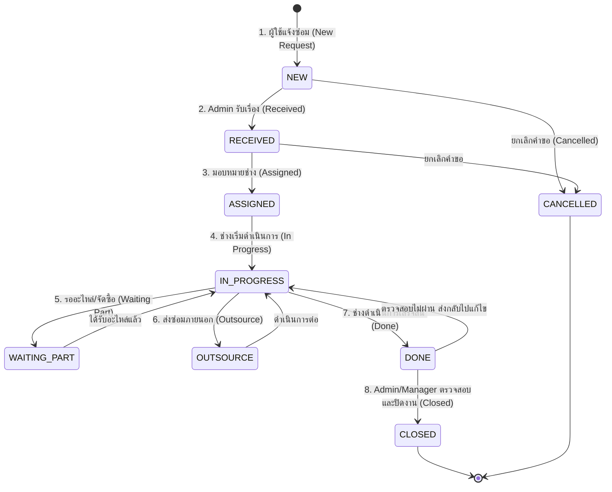

# 🔧 FRS : Facility Repair System (ระบบแจ้งซ่อมบำรุงออนไลน์ — Mobile Full Option)

<div align="center">

### Next-Gen Serverless Facility Repair & Maintenance Management Suite (Mobile-First Experience)

[](https://github.com/longzedesign-dotcom/FRSOnline)
[](https://github.com/longzedesign-dotcom/FRSOnline)
[](https://github.com/longzedesign-dotcom)
[](https://script.google.com/home/projects/1r67OX6cinXQJjCJKC39ZKutrYodlhxQ60gPb9rZ27M1mJ_HzWfOzPmfW/edit)
[-0F9D58?style=flat-square&logo=googlesheets)](https://docs.google.com/spreadsheets/d/1eI2xZjGpmKHhhpl3TIucxFbSe_aXzy3am2H-KieQjCk/edit)
[](LICENSE)

**🌐 URL ใช้งานระบบจริง (Web App Production URL):**  
[https://script.google.com/macros/s/AKfycbwGnIi6IsVMMDoymjWtDmgzGbN9TrH22es0RObGT0AJrHDw2UTJOMNfbbLz2dwXlulO/exec](https://script.google.com/macros/s/AKfycbwGnIi6IsVMMDoymjWtDmgzGbN9TrH22es0RObGT0AJrHDw2UTJOMNfbbLz2dwXlulO/exec)

</div>

---

## 🔗 ลิงก์ทรัพยากรโครงการทั้งหมด (Project Infrastructure Links)

| องค์ประกอบ | ชื่อ / ID | ลิงก์เข้าถึง |
| :--- | :--- | :--- |
| **GitHub Repository** | `longzedesign-dotcom/FRSOnline` | https://github.com/longzedesign-dotcom/FRSOnline |
| **Google Drive Root** | `FRS Online` (`1frevFQIOXmW5BMOkHWz02IcI2L4QW_0A`) | https://drive.google.com/drive/folders/1frevFQIOXmW5BMOkHWz02IcI2L4QW_0A |
| **Google Sheets Database** | `DBS_FRS` (`1eI2xZjGpmKHhhpl3TIucxFbSe_aXzy3am2H-KieQjCk`) | https://docs.google.com/spreadsheets/d/1eI2xZjGpmKHhhpl3TIucxFbSe_aXzy3am2H-KieQjCk/edit |
| **Google Drive Uploads** | `FRS_Uploads` (`1bxDK2QLZW_ySZKRfuMZvBuEDHELL9W0j`) | https://drive.google.com/drive/folders/1bxDK2QLZW_ySZKRfuMZvBuEDHELL9W0j |
| **Apps Script Project (Edit)** | `FRSOnline : ระบบแจ้งซ่อมบำรุง` (`1r67OX6cinXQJjCJKC39ZKutrYodlhxQ60gPb9rZ27M1mJ_HzWfOzPmfW`) | https://script.google.com/home/projects/1r67OX6cinXQJjCJKC39ZKutrYodlhxQ60gPb9rZ27M1mJ_HzWfOzPmfW/edit |
| **Web App Deploy (Exec)** | `AKfycbwGnIi...` (`FRS V2.3.09` · Deployment `@15`) | https://script.google.com/macros/s/AKfycbwGnIi6IsVMMDoymjWtDmgzGbN9TrH22es0RObGT0AJrHDw2UTJOMNfbbLz2dwXlulO/exec |

---

## 📖 สารบัญ
1. [ภาพรวมของระบบ (Overview)](#-ภาพรวมของระบบ-overview)
2. [ผังสถาปัตยกรรมและ Workflow หลัก (Architecture & Workflows)](#-ผังสถาปัตยกรรมและ-workflow-หลัก)
3. [ความสามารถหลักในโหมด Mobile Full Option (Key Features)](#-ความสามารถหลักในโหมด-mobile-full-option)
4. [โครงสร้างฐานข้อมูล Google Sheets (`DBS_FRS` — 13 ตาราง)](#-โครงสร้างฐานข้อมูล-google-sheets-dbs_frs--13-ตาราง)
5. [โครงสร้างไฟล์โค้ดของระบบ (Codebase Architecture)](#-โครงสร้างไฟล์โค้ดของระบบ-codebase-architecture)
6. [บัญชีผู้ใช้เริ่มต้นสำหรับการทดสอบ (Default Accounts)](#-บัญชีผู้ใช้เริ่มต้นสำหรับการทดสอบ-default-accounts)
7. [เอกสารคู่มือฉบับสมบูรณ์ (Full Documentation)](#-เอกสารคู่มือฉบับสมบูรณ์-full-documentation)

---

## 🌟 ภาพรวมของระบบ (Overview)

**FRS : Facility Repair System (ระบบแจ้งซ่อมบำรุงออนไลน์)** พัฒนาขึ้นด้วยสถาปัตยกรรม **100% Serverless** บน Google Workspace โดยใช้ **Google Apps Script (V8 Engine)** ขับเคลื่อน Web Application แบบ Single Page Application (SPA) เชื่อมต่อกับ **Google Sheets (`DBS_FRS`)** ทำหน้าที่เป็น Relational Database และจัดเก็บรูปภาพหลักฐานงานซ่อมบน **Google Drive (`FRS_Uploads`)**

**จุดเด่นสำคัญใน V2.3.09 Mobile Full Option:**
- **Mobile-First Experience**: หน้าจอปรับเข้ากับสมาร์ตโฟนทุกรุ่นอย่างลงตัว รองรับขอบจอ iPhone (Dynamic Island / Notch) ด้วย Safe Area Insets (`env(safe-area-inset-bottom)`)
- **Mobile Bottom Navigation & Badge Counter**: เมนูควบคุมล่างจอ พร้อมตัวเลขแจ้งเตือนจำนวนงานที่รอดำเนินการแบบ Real-time
- **Haptic Vibration Feedback**: ระบบสั่นตอบสนองนุ่มนวลเมื่อแตะเปลี่ยนแท็บ ให้ความรู้สึกเสมือน Native Mobile App
- **Dual-Action Camera Capture**: ถ่ายภาพหน้างานสดผ่านกล้องหลังมือถือ (`capture="environment"`) หรือเลือกรูปจากคลังภาพ พร้อมบีบอัดรูปภาพอัตโนมัติบนอุปกรณ์ผู้ใช้ทันที (Client Canvas Compression)
- **Quick Status Filter Chips**: แถบชิปปุ่มเลือกสถานะงานแบบเลื่อนแนวนอน กรองคิวงานได้รวดเร็วด้วยนิ้วเดียว
- **Direct Phone Call Action**: ปุ่มแตะโทรออกด่วน (`tel:`) สีเขียวสดใส ติดต่อผู้แจ้งซ่อมหรือช่างได้ทันใจ
- **Fullscreen Lightbox Photo Viewer**: แกลเลอรีรูปภาพก่อนและหลังซ่อม แตะเปิดดูรูปภาพขนาดเต็มจอพร้อมคำบรรยาย

---

## 🗺️ ผังสถาปัตยกรรมและ Workflow หลัก

### 1. ผังสถาปัตยกรรมระบบ (System Architecture)


### 2. วงจรสถานะงานซ่อม 9 ขั้นตอน (9-Stage Repair Workflow)


---

## ⚡ ความสามารถหลักในโหมด Mobile Full Option

| ฟังก์ชันการทำงาน | รายละเอียดทางเทคนิคและประสบการณ์ผู้ใช้ |
| :--- | :--- |
| **📱 Mobile Navigation** | แถบ Bottom Nav แบบกระจกฝ้า (Backdrop Blur) รองรับ iOS/Android Safe Area พร้อม Haptic Feedback |
| **📷 Smart Camera & Compression** | สลับถ่ายสดผ่านกล้องมือถือหรือเลือกจากแกลเลอรี บีบอัดภาพให้อัตโนมัติ (<2MB) ก่อนส่งเข้า Google Drive |
| **🏷️ Quick Filter Chips** | ปุ่มเลือกสถานะแบบเลื่อนแนวนอน (ทั้งหมด, แจ้งเรื่องใหม่, รับเรื่องแล้ว, มอบหมายแล้ว, กำลังดำเนินการ, รออะไหล่, ส่งซ่อมภายนอก, ซ่อมเสร็จแล้ว, ปิดงาน) |
| **📞 One-Touch Calling** | แตะปุ่ม `โทรออก` บนรายละเอียดงานเพื่อต่อสายตรงหาผู้แจ้งซ่อมผ่านแอปโทรศัพท์บนสมาร์ตโฟนทันที |
| **🖼️ Lightbox Photo Viewer** | แสดงการ์ดภาพ Thumbnail แตะขยายดูรูปก่อนซ่อมและหลังซ่อมแบบเต็มจอพร้อมซูมได้ |
| **📋 Bottom Sheet Modal** | หน้าต่างแจ้งเตือนและรายละเอียดงานเลื่อนขึ้นจากขอบล่างจอ (Bottom Sheet) พร้อมบาร์จับปัด แตะปิดง่าย |
| **⏱️ SLA Tracking & Analytics** | คำนวณ SLA อัตโนมัติตามมาตรฐานสากล (CRITICAL 4ชม., HIGH 8ชม., NORMAL 24ชม., LOW 72ชม., PM 168ชม.) |
| **🔒 Role-Based Access Control** | แบ่งสิทธิ์ 4 ระดับ: `USER` (ผู้แจ้ง), `TECHNICIAN` (ช่างซ่อม), `MANAGER` (ผู้จัดการ), `ADMIN` (ผู้ดูแลระบบ) |

---

## 🗄️ โครงสร้างฐานข้อมูล Google Sheets (`DBS_FRS` — 13 ตาราง)

Database Spreadsheet ID: **`1eI2xZjGpmKHhhpl3TIucxFbSe_aXzy3am2H-KieQjCk`**

| หมวดหมู่ | รายชื่อชีต (Sheet Names) | หน้าที่และรายละเอียด |
| :--- | :--- | :--- |
| **ความปลอดภัยและบัญชี (4 ชีต)** | `USERS` | บัญชีผู้ใช้งาน, ข้อมูลส่วนตัว, รหัสผ่านแฮช (PBKDF2 Salted SHA-256) |
| | `USER_IDENTITIES` | บัญชี Social Login ที่เชื่อมโยง (Google, LINE, Password) |
| | `REGISTRATION_REQUESTS` | รายการคำขอสมัครสมาชิกรอการตรวจสอบและอนุมัติ |
| | `OAUTH_STATE_STORE` | เก็บ State & Nonce ป้องกันการโจมตี CSRF ในกระบวนการ OAuth |
| **ข้อมูลหลัก Master Data (5 ชีต)** | `MASTER_STATUS` | สถานะงานซ่อม 9 ระดับ (NEW, RECEIVED, ASSIGNED, IN_PROGRESS, ฯลฯ) |
| | `MASTER_SLA` | กำหนด SLA และระยะเวลามาตรฐานตามระดับความเร่งด่วน |
| | `MASTER_SYSTEMS` | หมวดหมู่อุปกรณ์และระบบอาคาร (ไฟฟ้า, ประปา, แอร์, CCTV, ห้องประชุม ฯลฯ) |
| | `MASTER_LOCATIONS` | อาคาร, ชั้น, ห้อง และรหัส QR Code ประจำสถานที่ |
| | `MASTER_DEPARTMENTS` | รายชื่อฝ่ายและแผนกภายในองค์กร |
| **บันทึกใบงานซ่อม (2 ชีต)** | `REQUESTS` | ตารางจัดเก็บใบแจ้งซ่อมหลัก ข้อมูลอาการ รูปภาพ ค่าใช้จ่าย และผลการซ่อม |
| | `REQUEST_STATUS_LOG` | บันทึกประวัติและไทม์ไลน์การเปลี่ยนสถานะงานอย่างละเอียดทุกขั้นตอน |
| **เซสชันและตรวจสอบ (2 ชีต)** | `SESSION_STORE` | จัดการเซสชันการเข้าสู่ระบบแบบ Stateless Token พร้อมอายุการใช้งาน |
| | `LOGIN_AUDIT` | บันทึกประวัติการ Login สำเร็จ/ล้มเหลว พร้อม User Agent และ IP |

---

## 📂 โครงสร้างไฟล์โค้ดของระบบ (Codebase Architecture)

```
FRSOnline/
├── .clasp.json                      # การเชื่อมโยง Apps Script Project (Script ID: 1r67OX...)
├── .gitignore                       # ละเว้นไฟล์ที่ไม่จำเป็นในการขึ้น Git
├── README.md                        # เอกสารภาพรวมโครงการ มาตรฐาน ITSD
├── DATA_DIAGRAM_AND_WORKFLOW.md     # ER Diagram 13 ตาราง + ผังขั้นตอน 9 สถานะ
├── MANUAL_USER.md                   # คู่มือการใช้งานระบบฉบับสมบูรณ์ทุก Role
├── INSTALL_GUIDE.md                 # คู่มือการติดตั้งและ Deploy ผ่าน Clasp CLI
├── PATCH_NOTES.md                   # ประวัติการพัฒนาและ Release Notes สู่ Mobile Full Option
├── appsscript.json                  # Manifest (Asia/Bangkok, V8 Engine, Drive Scopes)
│
├── [Backend Services & Controllers]
├── Code.js                          # Entrypoint: doGet(), include() และ Public API Routing
├── Config.js                        # System Configuration, IDs, Enums, Roles & Policies
├── Setup.js                         # Database Initializer, Schema Definition & Demo Seeding
├── Utils.js                         # Cryptography, PBKDF2 Hashing, Date Formatter & Helpers
├── DataService.js                   # Google Sheets ORM & Cached Data Access Layer
├── AuthService.js                   # Authentication Controller, Password Verification & RBAC
├── Session.js                       # Session Storage & Token Lifecycle Management
├── MasterService.js                 # Master Data Service & Cached Lookups
├── RequestService.js                # Request Management & Creation Business Logic
├── WorkflowService.js               # 9-Stage Workflow Engine & SLA Duration Calculations
├── DashboardService.js              # KPI Statistics & Overview Data Aggregation
├── BootstrapService.js              # Initial App Payload & Session Hydration
├── UploadService.js                 # Google Drive Storage & Secure Image Uploader
├── IdentityService.js               # Multi-Identity Provider Integration Manager
├── LineAuthService.js               # LINE Login OAuth 2.0 Integration
├── GoogleAuthService.js             # Google OAuth 2.0 Integration
├── RegistrationService.js           # Self-Service Registration & Approval Workflow
├── SocialAuthConfig.js              # OAuth Client Configuration & Endpoints
├── SocialAuthService.js             # OAuth Handshake & State Exchange Service
├── FastUXTestFoundation.js          # Fast UX & End-to-End Test Engine
├── PerformanceTestFoundation.js     # Latency & Concurrency Stress Test Suite
│
└── [Frontend Views & Mobile UI Layer]
    ├── index.html                   # Mobile-First HTML5 Shell, Bottom Nav & Modal Layouts
    ├── style.html                   # CSS Design Tokens, Safe Area Insets, Theme & Mobile Components
    └── script.html                  # Client Controller (SPA), Haptic Engine, Camera & Image Viewer
```

---

## 👥 บัญชีผู้ใช้เริ่มต้นสำหรับการทดสอบ (Default Accounts)

| รหัสผู้ใช้ | Username | ชื่อ-นามสกุล | สิทธิ์ (Role) | รหัสผ่านเริ่มต้น | สถานะ |
| :---: | :---: | :--- | :---: | :---: | :---: |
| **U-ADMIN-001** | `admin` | ผู้ดูแลระบบ FRS | **ADMIN** | `Admin@1234` | พร้อมใช้งาน |
| **U-TECH-001** | `tech01` | ช่าง Facility 01 | **TECHNICIAN** | `Tech@1234` | พร้อมใช้งาน |
| **U-TECH-002** | `tech02` | ช่างระบบไฟฟ้า | **TECHNICIAN** | `Tech@1234` | พร้อมใช้งาน |
| **U-MANAGER-001** | `manager01` | หัวหน้างานอาคาร | **MANAGER** | `Manager@1234` | พร้อมใช้งาน |
| **U-USER-001** | `user01` | สมชาย แจ้งซ่อม | **USER** | `User@1234` | พร้อมใช้งาน |

---

## 📚 เอกสารคู่มือฉบับสมบูรณ์ (Full Documentation)

- **คู่มือการใช้งานระบบฉบับสมบูรณ์**: [`MANUAL_USER.md`](./MANUAL_USER.md)
- **คู่มือการติดตั้งและตั้งค่าระบบฉบับสมบูรณ์**: [`INSTALL_GUIDE.md`](./INSTALL_GUIDE.md)
- **Data Diagram (ER 13 ตาราง) & System Workflows**: [`DATA_DIAGRAM_AND_WORKFLOW.md`](./DATA_DIAGRAM_AND_WORKFLOW.md)
- **บันทึกการเปลี่ยนแปลง (Patch Notes)**: [`PATCH_NOTES.md`](./PATCH_NOTES.md)

---

<div align="center">
  <sub>พัฒนาและดูแลโดย LongZe Design © 2026 FRS : Facility Repair System (ระบบแจ้งซ่อมบำรุงออนไลน์)</sub>
</div>
